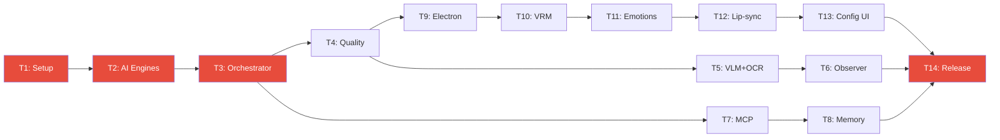

# DOK-16: IMPLEMENTATION_ROADMAP.md — Roadmapa Tygodniowa

> **Status:** v1.0 — 2026-05-02
> **14 tygodni × 5 dni × ~6h = ~420h pracy**
> **Szczegóły zadań:** [implementation_plan.md](implementation_plan.md) + [implementation_plan_part2.md](implementation_plan_part2.md)

---

## Faza 1 — Backend Core (Tygodnie 1–4)

### Tydzień 1: Setup + Interfaces + Config

| Dzień | Cel | Tasks | Estimate | DoD |
|-------|-----|-------|----------|-----|
| Pon–Wt | Projekt i środowisko | Content root, venv, requirements, backend dir structure, FastAPI skeleton, setup scripts | 12h | `uvicorn` startuje, verify_env passes |
| Śr | Config Loader | Pydantic V2 schema, loader (defaults<yaml<env), walidacja, 15 testów | 6h | `pytest tests/unit/test_config.py` passes |
| Czw | Interfaces + Core | Base classes (LLM/STT/TTS/VLM), GPUScheduler, CircuitBreaker | 6h | All ABC importable, GPU-T/CB-T tests pass |
| Pt | Database | SQLite DDL (14 tabel), MigrationRunner, repos, 10 CRUD tests | 6h | Migration runs, CRUD tests pass |

**Ryzyka:** Dependency conflicts (CUDA vs PyTorch versions)
**Buffer:** Piątek PM (15:00–18:00)

---

### Tydzień 2: AI Engines

| Dzień | Cel | Tasks | Estimate | DoD |
|-------|-----|-------|----------|-----|
| Pon | LLM Client | LMStudioClient, streaming SSE, function calling, CB integration, 8 testów | 6h | Mock streaming test passes |
| Wt | STT Engine | FasterWhisperSTT, confidence thresholds, GPU scheduler, 6 testów | 6h | Mock transcription passes |
| Śr | TTS Engine | PiperTTS, subprocess call, emotion modulation, chunked output, 6 testów | 6h | Mock TTS generates silence WAV |
| Czw | Wakeword + Audio | WakewordDetector, PTT handler, mode switching, audio duck | 6h | PTT capture works |
| Pt | Integration T2 | E2E: audio→STT→text, text→LLM→response, response→TTS→audio | 6h | Full pipeline mock test |

**Ryzyka:** Piper subprocess on Windows, Whisper CUDA compatibility

---

### Tydzień 3: Orchestrator + Commands

| Dzień | Cel | Tasks | Estimate | DoD |
|-------|-----|-------|----------|-----|
| Pon | PromptBuilder | Section assembly, trimming, PersonaLoader, token counting, 12 testów | 6h | Prompt builds correctly |
| Wt | Commands | EmotionParser, CommandMatcher (regex+fuzzy), handlers, 15 testów | 6h | CMD-T-01→11 pass |
| Śr | Orchestrator | Main pipeline, streaming, tool lifecycle, state machine | 6h | Full pipeline w/ mocks |
| Czw | API + WebSocket | REST routes, WebSocketManager, multiplexed events, 8 testów | 6h | httpx test client passes |
| Pt | MCP basics | get_current_time, calculator, ToolRegistry, E2E test | 6h | "Która godzina?" works |

**Ryzyka:** LLM response format inconsistency

---

### Tydzień 4: Quality + Performance

| Dzień | Cel | Tasks | Estimate | DoD |
|-------|-----|-------|----------|-----|
| Pon–Wt | Hardening | SessionWatchdog, crash recovery, graceful shutdown, health aggregation | 12h | WD-T-01→04 pass |
| Śr | Hot-reload | File watcher (watchdog), hot-reload per key, voice notification | 6h | Config change → voice notif |
| Czw–Pt | Performance | Baseline test z grą, FPS/latency measurement, bug bash, docs | 12h | **MILESTONE 1** |

**🏁 MILESTONE 1:** Rozmowa głosowa z terminala. Komendy systemowe. Performance < 5% FPS impact.

---

## Faza 2 — Vision, MCP, Memory (Tygodnie 5–8)

### Tydzień 5: Screen Capture + VLM + OCR

| Dzień | Cel | Tasks | Estimate |
|-------|-----|-------|----------|
| Pon | Screen Capture | DXcam + pyautogui fallback, monitor detection | 6h |
| Wt | VLM | Moondream2VLM, GPU scheduler P4 | 6h |
| Śr | OCR | EasyOCR, trigger keywords, dual pipeline | 6h |
| Czw | Scene detection | dHash, deduplication, frame crop | 6h |
| Pt | Integration | capture→VLM→description, OCR accuracy | 6h |

---

### Tydzień 6: Observer + Game Detection

| Dzień | Cel | Tasks | Estimate |
|-------|-----|-------|----------|
| Pon | Game Detector | psutil→VLM→manual cascade | 6h |
| Wt | Game Profiles | Pydantic loader, hot-reload, poe2+stellaris profiles | 6h |
| Śr | Observer Loop | Main loop, skip conditions, backpressure (DOK-08 §6) | 6h |
| Czw | Comment gen | Comment generator, diversity check, rate limiter | 6h |
| Pt | Pause/Resume | Integration z PTT, performance test, OBS-T-01→04 | 6h |

---

### Tydzień 7: MCP Tools + Cache

| Dzień | Cel | Tasks | Estimate |
|-------|-----|-------|----------|
| Pon | Sandbox | SandboxValidator, ToolRegistry, lifecycle | 6h |
| Wt | web_search | DuckDuckGo + TokenBucketRateLimiter | 6h |
| Śr | web_scraper | trafilatura + Playwright fallback | 6h |
| Czw | Other tools | generate_document, screen_capture | 6h |
| Pt | Cache + tests | MCPCache (SHA256+TTL), stampede prevention, MCP-T-01→13 | 6h |

---

### Tydzień 8: Memory + Player Profile

| Dzień | Cel | Tasks | Estimate |
|-------|-----|-------|----------|
| Pon | ChromaDB | 2 kolekcje setup, embedding model | 6h |
| Wt | Semantic Recall | Embed, query, dedup, format (DOK-11 §4) | 6h |
| Śr | Knowledge | Ingester, chunking, file watcher (DOK-11 §5) | 6h |
| Czw | Player Profile | YAML source, snapshots, season reset | 6h |
| Pt | Maintenance | FIFO rotation, auto-archive, backup/restore, daily meta | 6h |

**🏁 MILESTONE 2:** Asystent komentuje PoE2/Stellaris, szuka buildów, pamięta profil.

---

## Faza 3 — Frontend + Avatar (Tygodnie 9–14)

### Tydzień 9: Electron + React Skeleton

| Dzień | Cel | Tasks |
|-------|-----|-------|
| Pon | Electron main | BrowserWindow (transparent, AOT, frameless) |
| Wt | React skeleton | Vite build, preload.js, contextIsolation |
| Śr | WebSocket hook | useWebSocket, reconnect z backoff, event dispatch |
| Czw | System tray | Health icon colors, global hotkeys |
| Pt | IPC | Handlers, click-through toggle, REST client |

---

### Tydzień 10: Three.js + VRM

| Dzień | Cel | Tasks |
|-------|-----|-------|
| Pon | Scene setup | Camera, lighting, transparent background |
| Wt | VRM loading | @pixiv/three-vrm, capabilities scan |
| Śr | Idle anims | Breathing, blinking, random sway |
| Czw | Aura shader | PointLight, HSL lerp, pulse animation |
| Pt | Positioning | Drag & drop, resize, opacity, save |

---

### Tydzień 11: Emotion System

| Dzień | Cel | Tasks |
|-------|-----|-------|
| Pon | Data + state | Load emotions.json, EmotionController state machine |
| Wt | Blendshapes | Layer 1: per-emotion blendshape application |
| Śr | Aura | Layer 2: color/intensity/pulse mixing z visual states |
| Czw | Body | Layer 3: head tilt, oscillation, entry animations |
| Pt | Conflicts | Priority override, crossfade, queue. EMO-01→07 tests |

---

### Tydzień 12: Lip-sync + Audio

| Dzień | Cel | Tasks |
|-------|-----|-------|
| Pon | Lip-sync | Web Audio analyser, RMS→aa blendshape |
| Wt | Audio player | AudioContext, PCM decode, gain node, queue |
| Śr | Audio duck | <200ms ramp, volume interpolation |
| Czw | Visual states | Listening/thinking/speaking/error overlay |
| Pt | Text + sound | Text overlay (silent), notification chime |

---

### Tydzień 13: Config Panel + Wizard

| Dzień | Cel | Tasks |
|-------|-----|-------|
| Pon–Wt | Config Panel | 7 tabs (Audio, Avatar, Persona, Observer, MCP, Debug, Status) |
| Śr | Live preview | useConfig hook, debounced PUT, instant preview |
| Czw | Setup Wizard | 6 steps (deps→audio→avatar→persona→voice test→done) |
| Pt | Hotkeys + UI | Device selector, test buttons, shortcuts display |

---

### Tydzień 14: Polish + Release

| Dzień | Cel | Tasks |
|-------|-----|-------|
| Pon | Bug bash | Issue list, priorytetyzacja, critical fixes |
| Wt | Performance | FPS/VRAM/latency audit, optimization |
| Śr | Packaging | electron-builder, NSIS installer, icon, shortcut |
| Czw | Docs | README, CHANGELOG, LICENSES verification |
| Pt | Release | **Full E2E demo, acceptance tests, MILESTONE 3** |

**🏁 MILESTONE 3:** Kompletna aplikacja z awatarem 3D, gotowa do codziennego użytku.

---

## Critical Path

**Najdłuższa ścieżka:** T1→T2→T3→T4→T9→T10→T11→T12→T13→T14 (10 tygodni, backend+frontend serial)

---

## Buffer Rules

- Każdy piątek PM (15:00–18:00) = buffer na bug fixes
- Jeśli tydzień kończy się przed piątkiem → quality pass / refactoring
- Jeśli tydzień się opóźnia → cut scope wg [cut list](RISK_REGISTER.md#r05)

## What If Slipping?

| Opóźnienie | Akcja |
|------------|-------|
| 1 dzień | Użyj piątkowego buffera |
| 2–3 dni | Cut Could/Should features z bieżącego tygodnia |
| > 1 tydzień | Re-scope fazy. Przenieś Should features do "Faza 4" |

---

*Dokument: DOK-16 IMPLEMENTATION_ROADMAP.md v1.0 — 2026-05-02*
