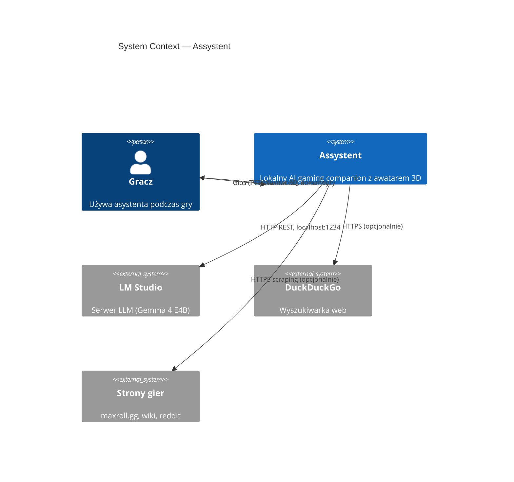
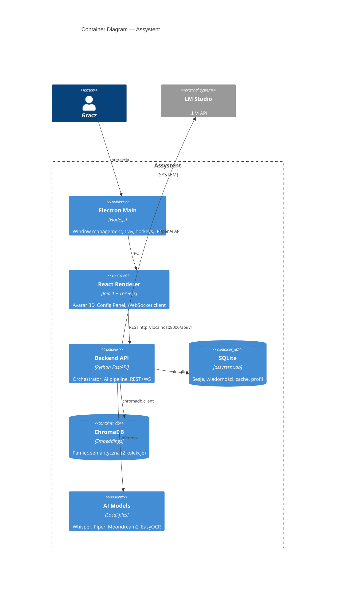
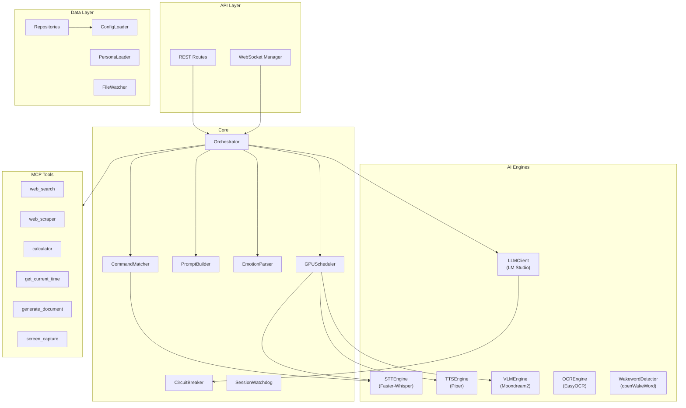
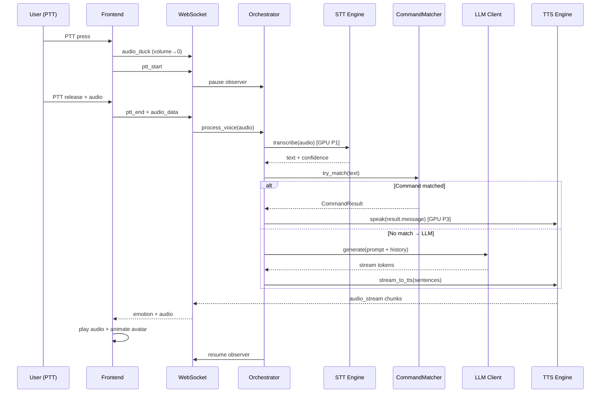
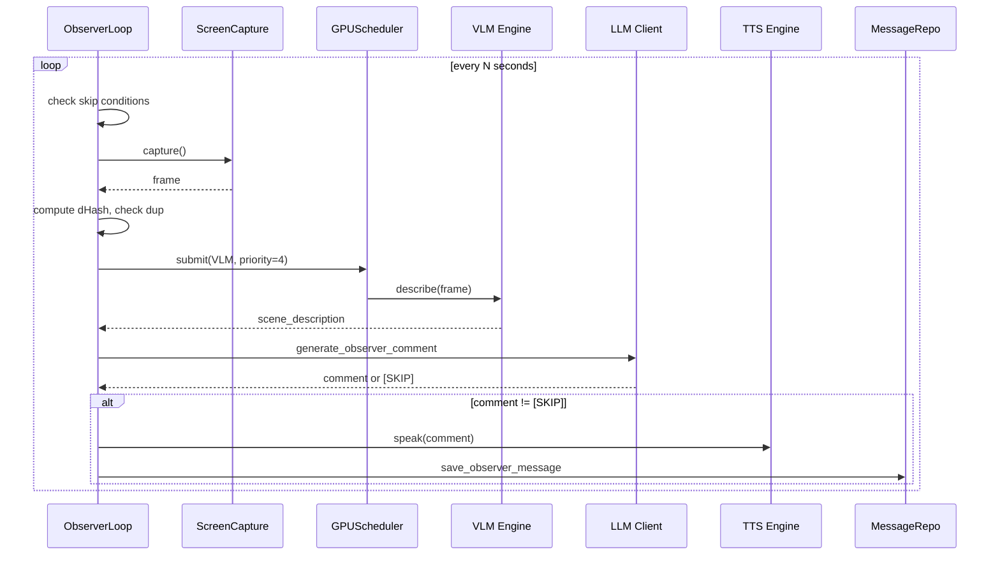

# Assystent — Pełny Plan Implementacji

> **Status:** v1.1 — 2026-05-02
> **Źródła:** Wszystkie 24 dokumenty DOK-01–DOK-16 + PRD 00-06
> **Pliki towarzyszące:** [Fazy 2–3 + Testy + Modele](implementation_plan_part2.md) · [TEST_PLAN](TEST_PLAN.md) · [DEFINITION_OF_DONE](DEFINITION_OF_DONE.md) · [RISK_REGISTER](RISK_REGISTER.md) · [IMPLEMENTATION_ROADMAP](IMPLEMENTATION_ROADMAP.md)

---

## 1. Analiza Braków w Dokumentacji

### 1.1 Brakujące dokumenty (DOK-13 → DOK-16)

| DOK | Nazwa | Status | Lokalizacja |
|-----|-------|--------|-------------|
| DOK-13 | TEST_PLAN.md | ✅ Utworzony | [docs/plan/TEST_PLAN.md](TEST_PLAN.md) |
| DOK-14 | DEFINITION_OF_DONE.md | ✅ Utworzony | [docs/plan/DEFINITION_OF_DONE.md](DEFINITION_OF_DONE.md) |
| DOK-15 | RISK_REGISTER.md | ✅ Utworzony | [docs/plan/RISK_REGISTER.md](RISK_REGISTER.md) |
| DOK-16 | IMPLEMENTATION_ROADMAP.md | ✅ Utworzony | [docs/plan/IMPLEMENTATION_ROADMAP.md](IMPLEMENTATION_ROADMAP.md) |

### 1.2 Niespójności wykryte między dokumentami

| # | Problem | Lokalizacja | Rozwiązanie |
|---|---------|-------------|-------------|
| 1 | CONFIG_SPEC definiuje `CommandParam` z `type: choice` ale COMMANDS_SPEC ma inną wersję bez `choices_dynamic` | DOK-03 §3.2 vs DOK-07 §2.1 | Użyj wersji z DOK-07 (pełniejsza) |
| 2 | OBSERVER_SPEC §3 definiuje `observer_type: "strategic"` ale CONFIG_SPEC §4.2 ma `"strategy"` | DOK-09 vs DOK-03 | Standaryzuj: `"strategy"` |
| 3 | MEMORY_SPEC nie definiuje `aiosqlite` w requirements ale używa go w kodzie | DOK-11 vs DOK-02 | Dodaj `aiosqlite>=0.20.0` do requirements.txt |
| 4 | PROMPT_SPEC używa `tiktoken` ale nie ma go w requirements.txt | DOK-05 vs DOK-02 | Dodaj `tiktoken>=0.7.0` lub zastąp approx. tokenizerem |
| 5 | `librosa` wymagane przez EMOTION_SPEC §10.1 TTS modulation — brak w requirements | DOK-06 vs DOK-02 | Dodaj `librosa>=0.10.0` i `soundfile>=0.12.0` |
| 6 | DB_SCHEMA definiuje 14 tabel ale MEMORY_SPEC repositories pokrywają tylko ~10 | DOK-04 vs DOK-11 | Uzupełnić brakujące: `KnowledgeRepository`, `DailyCheckRepository` |
| 7 | Quiet hours: CONFIG_SPEC mówi "start może być > end (overflow)" ale walidator sprawdza tylko format HH:MM | DOK-03 §2.4 | Implementacja musi obsłużyć cross-midnight |

### 1.3 Brakujące elementy w istniejących dokumentach

- **Orchestrator** — brak dedykowanej specyfikacji klasy `Orchestrator` (rozproszony między DOK-05, DOK-07, DOK-08)
- **Streaming pipeline** — DOK-08 §9 definiuje algorytm ale brak integracji z WebSocket z DOK-04
- **Health check aggregation** — API-plan definiuje `/health` i `/status` ale brak logiki agregacji stanów komponentów
- **Graceful shutdown** — brak procedury zamykania (save session, close DB, stop observer)

---

## 2. Architektura C4

### 2.1 Context Diagram (Level 1)

### 2.2 Container Diagram (Level 2)

### 2.3 Component Diagram (Level 3 — Backend)

---

## 3. Mapa Komunikacji

### 3.1 Flow: PTT → Response

### 3.2 Flow: Observer Loop

### 3.3 WebSocket Events (multiplexed)

| Event | Direction | Payload | Trigger |
|-------|-----------|---------|---------|
| `emotion` | BE→FE | `{emotion: string}` | LLM response parsed |
| `audio_stream` | BE→FE | `{chunk_base64: string}` | TTS generates audio |
| `system_state` | BE→FE | `{state: string, health: string}` | State change |
| `audio_duck` | BE→FE | `{target_volume: float, ramp_ms: int}` | PTT start/end |
| `text_overlay` | BE→FE | `{text: string}` | Silent mode response |
| `visual_state` | BE→FE | `{state: string}` | Pipeline state change |
| `ping/pong` | Both | `{}` | Heartbeat 30s |
| `frontend_ready` | FE→BE | `{}` | FE connected |
| `ptt_start/end` | FE→BE | `{audio?: base64}` | User PTT |

---

## 4. Fazy Implementacji — Przegląd

| Faza | Tygodnie | Cel | Kamień milowy |
|------|----------|-----|---------------|
| **1: Backend Core** | T1–T4 | Pipeline głosowy PTT→STT→LLM→TTS | Rozmowa z terminala |
| **2: Vision+MCP+Memory** | T5–T8 | Observer, web tools, pamięć | Komentuje grę, szuka buildów |
| **3: Frontend+Avatar** | T9–T14 | Electron + 3D avatar + emotions | Kompletna aplikacja |

---

## 5. Faza 1 — Backend Core (T1–T4)

### T1: Setup + Interfaces + Config

#### Dzień 1–2: Projekt i środowisko
- `[ ]` Wykonaj ENV_SETUP.md — content root, venv, requirements
- `[ ]` Struktura backend: `backend/{api,core,config,db,ai,mcp,services}/`
- `[ ]` `__init__.py`, `main.py` (FastAPI app skeleton)
- `[ ]` `scripts/setup.ps1`, `scripts/verify_env.py`
- **Model:** Gemini 2.5 Flash — boilerplate setup

#### Dzień 3: Config Loader
- `[ ]` `backend/config/schema.py` — Pydantic V2 models (z DOK-03)
- `[ ]` `backend/config/loader.py` — hierarchia: defaults < yaml < env
- `[ ]` Walidacja semantyczna (cross-field)
- `[ ]` Zapis znormalizowanej konfiguracji
- `[ ]` 15 unit testów (walidacja, defaults, env override)
- **Model:** Gemini 2.5 Pro — complex Pydantic schemas

#### Dzień 4: Interfaces + Base Classes
- `[ ]` `BaseLLMClient`, `BaseSTTEngine`, `BaseTTSEngine`, `BaseVLMAnalyzer`
- `[ ]` `StorageBackend` + `SQLiteBackend` (aiosqlite)
- `[ ]` `BaseRepository` + concrete repos (Session, Message)
- `[ ]` `GPUScheduler` (z DOK-08 §1)
- `[ ]` `CircuitBreaker` (z DOK-08 §2)
- **Model:** Gemini 2.5 Pro — architecture patterns

#### Dzień 5: Database
- `[ ]` `backend/db/migrations/001_initial.sql` — 14 tabel z DB_SCHEMA
- `[ ]` `MigrationRunner` (z DOK-11 §12)
- `[ ]` SQLite pragmas (WAL, foreign keys)
- `[ ]` `conftest.py` z in-memory fixtures
- `[ ]` 10 testów CRUD dla SessionRepo, MessageRepo
- **Model:** Gemini 2.5 Flash — SQL DDL generation

### T2: AI Engines (STT + TTS + LLM)

#### Dzień 1: LLM Client
- `[ ]` `LMStudioClient(BaseLLMClient)` — OpenAI-compatible
- `[ ]` Streaming response (SSE token-by-token)
- `[ ]` Function calling support (tools array)
- `[ ]` Circuit breaker integration
- `[ ]` 8 testów (mock httpx responses)
- **Model:** Gemini 2.5 Pro — async streaming patterns

#### Dzień 2: STT Engine
- `[ ]` `FasterWhisperSTT(BaseSTTEngine)` — GPU scheduler integration
- `[ ]` Confidence threshold logic (high/low/reject)
- `[ ]` Audio preprocessing (format normalization)
- `[ ]` 6 testów z mock audio
- **Model:** Gemini 2.5 Flash — adapter pattern

#### Dzień 3: TTS Engine
- `[ ]` `PiperTTS(BaseTTSEngine)` — subprocess binary call
- `[ ]` Emotion modulation (speed/pitch z DOK-06 §10)
- `[ ]` Audio output streaming (chunked WAV)
- `[ ]` 6 testów
- **Model:** Gemini 2.5 Flash — subprocess integration

#### Dzień 4: Wakeword + Audio Input
- `[ ]` `WakewordDetector` — openWakeWord integration
- `[ ]` `AudioCapture` — pynput PTT handler
- `[ ]` PTT vs wakeword mode switching
- `[ ]` Audio duck event emission
- **Model:** Gemini 2.5 Flash — hardware integration

#### Dzień 5: Integration test T2
- `[ ]` End-to-end: audio→STT→text, text→LLM→response, response→TTS→audio
- `[ ]` GPU scheduler verification (sequential execution)
- `[ ]` Buffer + bug fixes

### T3: Orchestrator + Commands

#### Dzień 1: PromptBuilder
- `[ ]` `PromptBuilder` (z DOK-05 §3) — section assembly + trimming
- `[ ]` PersonaLoader — YAML frontmatter + markdown body
- `[ ]` Token counting (approx. or tiktoken)
- `[ ]` 12 testów
- **Model:** Gemini 2.5 Pro — complex prompt logic

#### Dzień 2: EmotionParser + CommandMatcher
- `[ ]` `parse_emotion_tag()` (z DOK-06 §8)
- `[ ]` `CommandMatcher` — normalize, regex match, fuzzy (z DOK-07)
- `[ ]` `CooldownTracker`, `ConfirmationSession`
- `[ ]` Handler registry + 16 builtin handlers
- `[ ]` 15 testów (CMD-T-01 → CMD-T-15 z DOK-07 §13)
- **Model:** Gemini 2.5 Pro — regex + NLP matching

#### Dzień 3: Orchestrator
- `[ ]` `Orchestrator` — main pipeline: voice→command?→LLM→TTS
- `[ ]` Streaming response pipeline (DOK-08 §9)
- `[ ]` Tool call lifecycle (max 5 per turn)
- `[ ]` State machine (Idle/Listening/Thinking/Speaking)
- **Model:** Gemini 2.5 Pro — complex state management

#### Dzień 4: API + WebSocket
- `[ ]` REST routes: `/health`, `/status`, `/config`, `/voice/*`
- `[ ]` `WebSocketManager` — multiplexed events
- `[ ]` Session management (create on connect, close on disconnect)
- `[ ]` 8 testów (httpx test client)
- **Model:** Gemini 2.5 Pro — FastAPI + WebSocket

#### Dzień 5: MCP basics + integration
- `[ ]` `get_current_time` tool
- `[ ]` `calculator` tool (asteval)
- `[ ]` Tool registry + schemas
- `[ ]` End-to-end test: full voice pipeline
- **Model:** Gemini 2.5 Flash — simple tools

### T4: Quality + Performance

#### Dzień 1–2: Session Watchdog + Hardening
- `[ ]` `SessionWatchdog` (DOK-08 §3)
- `[ ]` Crash detection on startup
- `[ ]` Graceful shutdown procedure
- `[ ]` Health aggregation logic
- `[ ]` SystemState repository

#### Dzień 3: File watcher + Hot-reload
- `[ ]` `watchdog` integration for config/, personas/
- `[ ]` Hot-reload per key (tabela z DOK-03 §7)
- `[ ]` Voice notification on config change

#### Dzień 4–5: Performance + Buffer
- `[ ]` Performance baseline test z grą (PoE2/Stellaris)
- `[ ]` FPS impact measurement (<5% target)
- `[ ]` Latency measurement (PTT→first audio <3s)
- `[ ]` Bug fixes, code review, documentation
- `[ ]` **MILESTONE: Rozmowa głosowa z terminala działa**

---

> **Kontynuacja:** Fazy 2–3, strategia testów, rekomendacje modeli AI i ścieżka krytyczna → [implementation_plan_part2.md](implementation_plan_part2.md)
