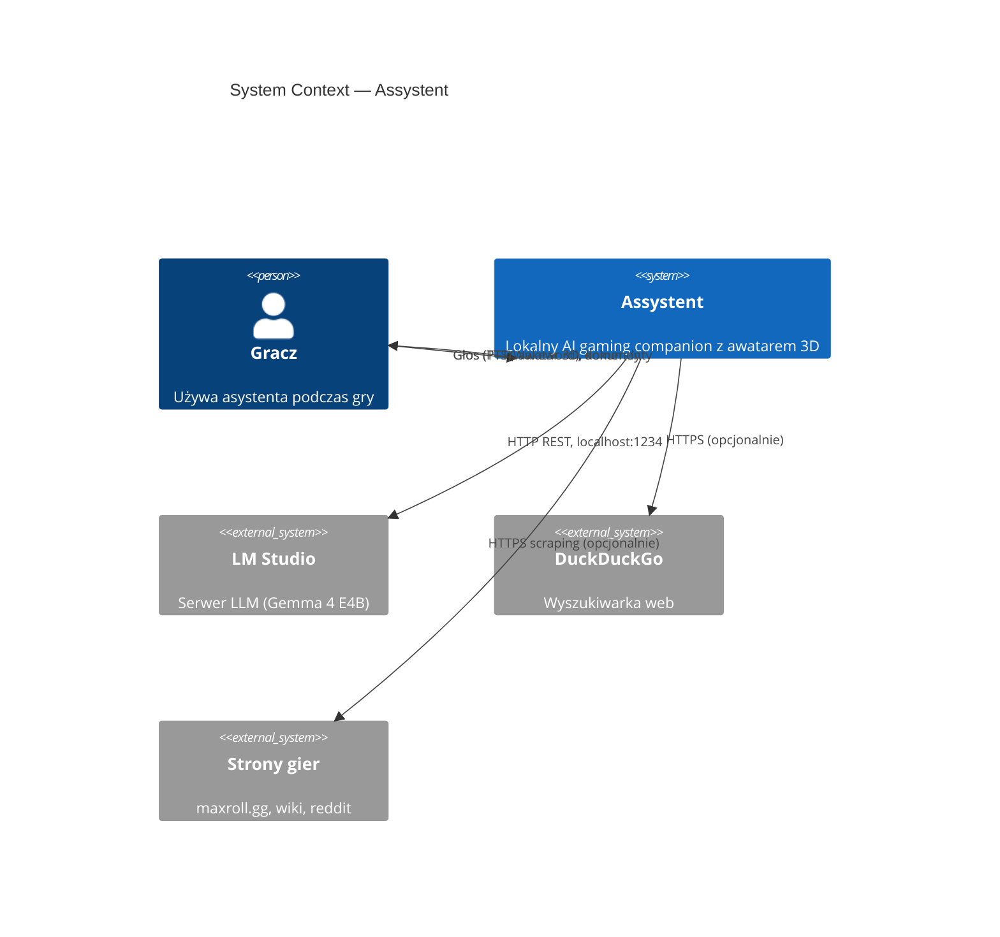
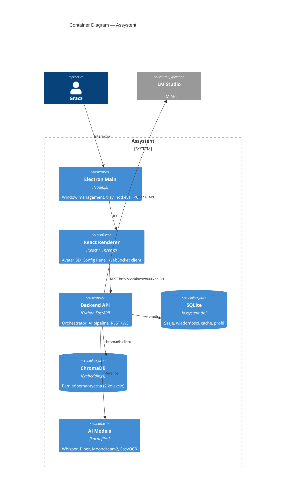
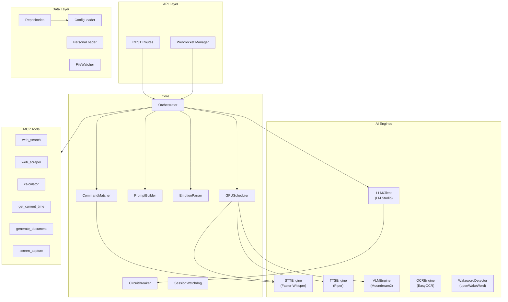
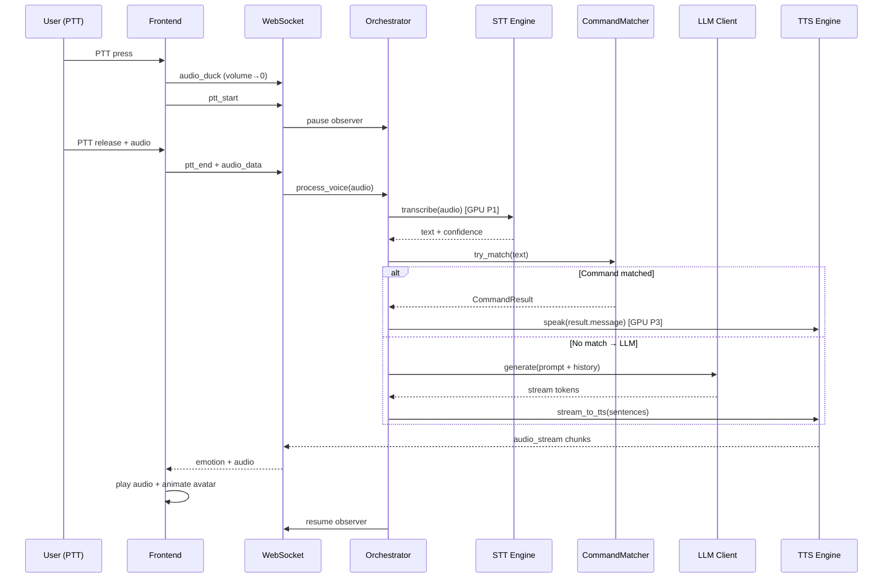
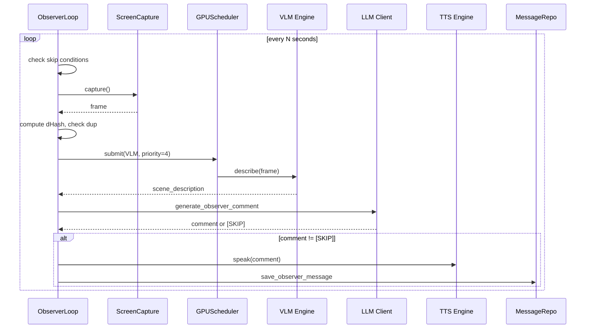

# Assystent — Pełny Plan Implementacji

> **Status:** v1.2 — 2026-05-04 (sekcja „Stan wdrożenia” + checklist Fazy 1)
> **Źródła:** Wszystkie 24 dokumenty DOK-01–DOK-16 + PRD 00-06
> **Pliki towarzyszące:** [Fazy 2–3 + Testy + Modele](implementation_plan_part2.md) · [TEST_PLAN](TEST_PLAN.md) · [DEFINITION_OF_DONE](DEFINITION_OF_DONE.md) · [RISK_REGISTER](RISK_REGISTER.md) · [IMPLEMENTATION_ROADMAP](IMPLEMENTATION_ROADMAP.md)

---

## 1. Analiza Braków w Dokumentacji

### 1.1 Brakujące dokumenty (DOK-13 → DOK-16)

| DOK    | Nazwa                     | Status      | Lokalizacja                                                      |
| ------ | ------------------------- | ----------- | ---------------------------------------------------------------- |
| DOK-13 | TEST_PLAN.md              | ✅ Utworzony | [docs/plan/TEST_PLAN.md](TEST_PLAN.md)                           |
| DOK-14 | DEFINITION_OF_DONE.md     | ✅ Utworzony | [docs/plan/DEFINITION_OF_DONE.md](DEFINITION_OF_DONE.md)         |
| DOK-15 | RISK_REGISTER.md          | ✅ Utworzony | [docs/plan/RISK_REGISTER.md](RISK_REGISTER.md)                   |
| DOK-16 | IMPLEMENTATION_ROADMAP.md | ✅ Utworzony | [docs/plan/IMPLEMENTATION_ROADMAP.md](IMPLEMENTATION_ROADMAP.md) |

### 1.2 Niespójności wykryte między dokumentami

| #   | Problem                                                                                                      | Lokalizacja                | Rozwiązanie                                                        |
| --- | ------------------------------------------------------------------------------------------------------------ | -------------------------- | ------------------------------------------------------------------ |
| 1   | CONFIG_SPEC definiuje `CommandParam` z `type: choice` ale COMMANDS_SPEC ma inną wersję bez `choices_dynamic` | DOK-03 §3.2 vs DOK-07 §2.1 | Użyj wersji z DOK-07 (pełniejsza)                                  |
| 2   | OBSERVER_SPEC §3 definiuje `observer_type: "strategic"` ale CONFIG_SPEC §4.2 ma `"strategy"`                 | DOK-09 vs DOK-03           | Standaryzuj: `"strategy"`                                          |
| 3   | MEMORY_SPEC nie definiuje `aiosqlite` w requirements ale używa go w kodzie                                   | DOK-11 vs DOK-02           | Dodaj `aiosqlite>=0.20.0` do requirements.txt                      |
| 4   | PROMPT_SPEC używa `tiktoken` ale nie ma go w requirements.txt                                                | DOK-05 vs DOK-02           | Dodaj `tiktoken>=0.7.0` lub zastąp approx. tokenizerem             |
| 5   | `librosa` wymagane przez EMOTION_SPEC §10.1 TTS modulation — brak w requirements                             | DOK-06 vs DOK-02           | Dodaj `librosa>=0.10.0` i `soundfile>=0.12.0`                      |
| 6   | DB_SCHEMA definiuje 14 tabel ale MEMORY_SPEC repositories pokrywają tylko ~10                                | DOK-04 vs DOK-11           | Uzupełnić brakujące: `KnowledgeRepository`, `DailyCheckRepository` |
| 7   | Quiet hours: CONFIG_SPEC mówi "start może być > end (overflow)" ale walidator sprawdza tylko format HH:MM    | DOK-03 §2.4                | Implementacja musi obsłużyć cross-midnight                         |

### 1.3 Brakujące elementy w istniejących dokumentach

- **Orchestrator** — brak dedykowanej specyfikacji klasy `Orchestrator` (rozproszony między DOK-05, DOK-07, DOK-08)
- **Streaming pipeline** — DOK-08 §9 definiuje algorytm ale brak integracji z WebSocket z DOK-04
- **Health check aggregation** — API-plan definiuje `/health` i `/status` ale brak logiki agregacji stanów komponentów
- **Graceful shutdown** — brak procedury zamykania (save session, close DB, stop observer)

---

## 2. Architektura C4

### 2.1 Context Diagram (Level 1)

### 2.2 Container Diagram (Level 2)

### 2.3 Component Diagram (Level 3 — Backend)

---

## 3. Mapa Komunikacji

### 3.1 Flow: PTT → Response

### 3.2 Flow: Observer Loop

### 3.3 WebSocket Events (multiplexed)

| Event            | Direction | Payload                                | Trigger               |
| ---------------- | --------- | -------------------------------------- | --------------------- |
| `emotion`        | BE→FE     | `{emotion: string}`                    | LLM response parsed   |
| `audio_stream`   | BE→FE     | `{chunk_base64: string}`               | TTS generates audio   |
| `system_state`   | BE→FE     | `{state: string, health: string}`      | State change          |
| `audio_duck`     | BE→FE     | `{target_volume: float, ramp_ms: int}` | PTT start/end         |
| `text_overlay`   | BE→FE     | `{text: string}`                       | Silent mode response  |
| `visual_state`   | BE→FE     | `{state: string}`                      | Pipeline state change |
| `ping/pong`      | Both      | `{}`                                   | Heartbeat 30s         |
| `frontend_ready` | FE→BE     | `{}`                                   | FE connected          |
| `ptt_start/end`  | FE→BE     | `{audio?: base64}`                     | User PTT              |

---

## 4. Fazy Implementacji — Przegląd

| Faza                     | Tygodnie | Cel                              | Kamień milowy                |
| ------------------------ | -------- | -------------------------------- | ---------------------------- |
| **1: Backend Core**      | T1–T4    | Pipeline głosowy PTT→STT→LLM→TTS | Rozmowa z terminala          |
| **2: Vision+MCP+Memory** | T5–T8    | Observer, web tools, pamięć      | Komentuje grę, szuka buildów |
| **3: Frontend+Avatar**   | T9–T14   | Electron + 3D avatar + emotions  | Kompletna aplikacja          |

---

## 5. Faza 1 — Backend Core (T1–T4)

### 5.0 Stan wdrożenia w repo (2026-05-04)

| Tydzień | Ocena  | Uwagi                                                                                                                                                                                                                                                                                                                                                                                                                        |
| ------- | ------ | ---------------------------------------------------------------------------------------------------------------------------------------------------------------------------------------------------------------------------------------------------------------------------------------------------------------------------------------------------------------------------------------------------------------------------- |
| **T1**  | ✅ ~90% | Środowisko i struktura katalogów, `ConfigLoader` + `tests/unit/test_config.py`, klasy bazowe i `MigrationRunner`, repozytoria na `aiosqlite`. Plan wspominał `StorageBackend`/`SQLiteBackend` — w kodzie jest bezpośredni dostęp przez repozytoria (bez osobnej warstwy „StorageBackend”). Liczba tabel w `001_initial.sql`: 12 tabel domenowych + `schema_migrations` (należy zweryfikować względem pełnego DB_SCHEMA 14×). |
| **T2**  | ✅ ~95% | `LMStudioClient`, `FasterWhisperSTT`, `PiperTTS`, testy. `VoiceInputCoordinator` + duck WS z backendu; `**PTTHotkeyListener` (pynput)** opcjonalnie (`audio.backend_ptt_listener_enabled`). `**WakewordDetector`** — openWakeWord lazy-load, domyślnie `hey_jarvis`, `detect_in_chunk()`; mikrofon ciągły → kolejny krok integracji.                                                                                         |
| **T3**  | ✅ ~85% | `PromptBuilder`, `PersonaLoader`, tiktoken, `parse_emotion_tag`, `CommandMatcher`, `ConversationOrchestrator` ze statusem fazy i narzędziami (limit z config). REST + WebSocket (`WebSocketManager` w `app_context`), testy API/WS/SSE. MCP: rejestr + czas + kalkulator + `random_choice` / `dice_roll` / `format_duration` (poza minimalnym zakresem planu).                                                               |
| **T4**  | ✅ ~85% | Watchdog + recovery + hot-reload + health snapshot + DB pod `{content_root}/data/`; smoke wydajności mock pipeline. FPS w grze / pełny PTT UI — poza zakresem backend-only.                                                                                                                                                                                                                                                  |

---

### T1: Setup + Interfaces + Config

#### Dzień 1–2: Projekt i środowisko

- `[x]` Wykonaj ENV_SETUP.md — content root, venv, requirements
- `[x]` Struktura backend: `backend/{api,core,config,db,ai,mcp,services}/`
- `[x]` `__init__.py`, `main.py` (FastAPI app skeleton)
- `[x]` `scripts/setup.ps1`, `scripts/verify_env.py`
- **Model:** Gemini 2.5 Flash — boilerplate setup

#### Dzień 3: Config Loader

- `[x]` `backend/config/schema.py` — Pydantic V2 models (z DOK-03)
- `[x]` `backend/config/loader.py` — hierarchia: defaults < yaml < env
- `[x]` Walidacja semantyczna (cross-field)
- `[ ]` Zapis znormalizowanej konfiguracji (nie zweryfikowano wyczerpująco)
- `[~]` Unit testy config — `tests/unit/test_config.py` (pełna liczba „15” nie assertowana w docs)
- **Model:** Gemini 2.5 Pro — complex Pydantic schemas

#### Dzień 4: Interfaces + Base Classes

- `[x]` `BaseLLMClient`, `BaseSTTEngine`, `BaseTTSEngine`, `BaseVLMAnalyzer`
- `[ ]` `StorageBackend` + `SQLiteBackend` (aiosqlite) — **nie wdrożono**; CRUD przez repozytoria
- `[~]` `BaseRepository` — brak wspólnej klasy bazowej; repozytoria konkretne w `repositories.py`
- `[x]` `GPUScheduler` (z DOK-08 §1)
- `[x]` `CircuitBreaker` (z DOK-08 §2)
- **Model:** Gemini 2.5 Pro — architecture patterns

#### Dzień 5: Database

- `[x]` `backend/db/migrations/001_initial.sql` — schemat zgodny z DB_SCHEMA (12 tabel biznesowych + migracje; porównać z doc „14 tabel”)
- `[x]` `MigrationRunner` (z DOK-11 §12)
- `[x]` SQLite pragmas (WAL, foreign keys) — w kodzie połączenia
- `[x]` `conftest.py` z in-memory fixtures
- `[x]` Testy CRUD / DB — `tests/unit/test_db.py` i integracje
- **Model:** Gemini 2.5 Flash — SQL DDL generation

### T2: AI Engines (STT + TTS + LLM)

#### Dzień 1: LLM Client

- `[x]` `LMStudioClient(BaseLLMClient)` — OpenAI-compatible
- `[x]` Streaming response (SSE token-by-token)
- `[x]` Function calling support (tools array)
- `[x]` Circuit breaker integration
- `[x]` Testy z mock httpx — `tests/unit/test_llm_client.py`, integracje SSE
- **Model:** Gemini 2.5 Pro — async streaming patterns

#### Dzień 2: STT Engine

- `[x]` `FasterWhisperSTT(BaseSTTEngine)` — GPU scheduler integration
- `[x]` Confidence threshold logic (high/low/reject)
- `[x]` Audio preprocessing (format normalization)
- `[x]` Testy — `tests/unit/test_faster_whisper_stt.py`
- **Model:** Gemini 2.5 Flash — adapter pattern

#### Dzień 3: TTS Engine

- `[x]` `PiperTTS(BaseTTSEngine)` — subprocess binary call
- `[x]` Emotion modulation (speed/pitch z DOK-06 §10) — moduł `tts_emotion.py`
- `[x]` Audio output streaming (chunked WAV)
- `[x]` Testy — `tests/unit/test_piper_tts.py`
- **Model:** Gemini 2.5 Flash — subprocess integration

#### Dzień 4: Wakeword + Audio Input

- `[x]` `WakewordDetector` — **openWakeWord** (lazy `Model`, lista modeli z configu, domyślnie `hey_jarvis`); `detect_in_chunk(pcm int16 mono 16 kHz)`; bez pakietu — graceful degrade
- `[x]` **Backendowy PTT** — `PTTHotkeyListener` (pynput global listener → `VoiceInputCoordinator`); włączanie `audio.backend_ptt_listener_enabled`; **AudioCapture** mikrofonu ciągłość nadal przez frontend / przyszły moduł
- `[x]` PTT vs wakeword — `audio.input_mode`; duck broadcast na WS z `lifespan`
- `[x]` Audio duck event emission — `VoiceInputCoordinator`
- **Model:** Gemini 2.5 Flash — hardware integration

#### Dzień 5: Integration test T2

- `[x]` End-to-end (mock): audio→STT→… — `tests/integration/test_voice_pipeline_mock.py`, `test_e2e_orchestrator.py`
- `[~]` GPU scheduler verification — częściowo przez testy STT
- `[x]` Buffer + bug fixes — iteracyjnie w repo
- **Model:** —

### T3: Orchestrator + Commands

#### Dzień 1: PromptBuilder

- `[x]` `PromptBuilder` (z DOK-05 §3) — section assembly + trimming
- `[x]` PersonaLoader — YAML frontmatter + markdown body
- `[x]` Token counting (approx. or tiktoken)
- `[x]` Testy — `tests/unit/test_prompt_builder.py`
- **Model:** Gemini 2.5 Pro — complex prompt logic

#### Dzień 2: EmotionParser + CommandMatcher

- `[x]` `parse_emotion_tag()` (z DOK-06 §8)
- `[x]` `CommandMatcher` — normalize, regex match, fuzzy (z DOK-07)
- `[x]` `CooldownTracker`, `ConfirmationSession` (w `command_matching`)
- `[~]` Handler registry + builtin handlers — zaimplementowane; liczba „16” nie zweryfikowana w tym dokumencie
- `[x]` Testy — `tests/unit/test_command_matcher.py`, `test_emotion_parser.py`
- **Model:** Gemini 2.5 Pro — regex + NLP matching

#### Dzień 3: Orchestrator

- `[x]` `ConversationOrchestrator` — pipeline: komendy → LLM → TTS-side effects
- `[x]` Streaming response pipeline (fragmenty DOK-08)
- `[x]` Tool call lifecycle (max z `ai_runtime.max_tool_calls_per_turn`)
- `[x]` State machine (Idle/Listening/Thinking/Speaking) — `OrchestratorState`
- **Model:** Gemini 2.5 Pro — complex state management

#### Dzień 4: API + WebSocket

- `[~]` REST routes: `/health`, `/status` tak; pełna lista `/config`, `/voice/`* — zweryfikuj `routes.py`
- `[x]` `WebSocketManager` — multiplexed events
- `[x]` Session management (create on connect, close on disconnect)
- `[x]` Testy klienta — `tests/integration/test_api_http_ws.py`, `test_ws_chat.py`
- **Model:** Gemini 2.5 Pro — FastAPI + WebSocket

#### Dzień 5: MCP basics + integration

- `[x]` `get_current_time` tool
- `[x]` `calculator` tool (asteval)
- `[x]` Tool registry + schemas
- `[x]` Narzędzia dodatkowe w `tools_extra.py` (poza planem dnia 5)
- `[x]` Testy rejestru / narzędzi — `test_mcp_registry.py`, `test_mcp_tools_extra.py`
- **Model:** Gemini 2.5 Flash — simple tools

### T4: Quality + Performance

#### Dzień 1–2: Session Watchdog + Hardening

- `[x]` `SessionWatchdog` — pętla w `lifespan`, sync CB, hibernacja + `health_events`
- `[x]` Crash detection on startup — `recover_stale_sessions`, niezamknięte `sessions` → `crashed`
- `[x]` Graceful shutdown — watchdog, hot-reload, `game_observer`, LLM
- `[x]` Health aggregation — `build_health_snapshot` w `/api/v1/status` i `/api/v1/health`
- `[x]` SystemState — aktualizacja przy recovery, CB i hibernacji

#### Dzień 3: File watcher + Hot-reload

- `[x]` `watchdog` — config YAML (katalog pliku) oraz `personas/`
- `[x]` Hot-reload — `apply_reload_configuration` (orchestrator, persony, LLM, STT/TTS, observer)
- `[~]` Voice notification — WS `config_reloaded` + `text_overlay` (TTS docelowo w kliencie)

#### Dzień 4–5: Performance + Buffer

- `[~]` Performance baseline — smoke mock pipeline (`test_performance_baseline.py`); brak testu FPS w grze
- `[ ]` FPS impact measurement (<5% target)
- `[ ]` Latency PTT→audio — backend gotowy; pomiar end-to-end z frontem / klientem
- `[x]` Testy recovery (`test_crash_recovery.py`) + aktualizacja integracji health
- `[~]` **MILESTONE głosowy** — ścieżka backend+WS działa; pełne PTT z UI w Fazie 3

---

> **Kontynuacja:** Fazy 2–3, strategia testów, rekomendacje modeli AI i ścieżka krytyczna → [implementation_plan_part2.md](implementation_plan_part2.md)

