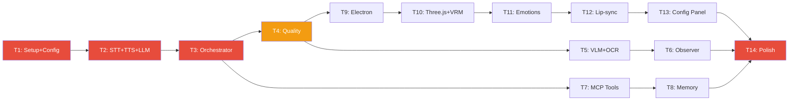

# Assystent — Plan Implementacji: Fazy 2–3, Testy, Modele AI

> **Status:** v1.8 — 2026-05-05 (T10–T14 baseline: VRM + `emotions.json` + WS audio; ConfigPanel; `electron-builder` NSIS; stosy Three z R3F 8 / three 0.169)
> **Kontekst:** [Plan główny (Faza 1)](implementation_plan.md) · [TEST_PLAN](TEST_PLAN.md) · [DEFINITION_OF_DONE](DEFINITION_OF_DONE.md) · [RISK_REGISTER](RISK_REGISTER.md) · [ROADMAP](IMPLEMENTATION_ROADMAP.md)

---

## Stan wdrożenia — 2026-05-05 (v1.8)

| Zakres                    | Stan        | Uwagi                                                                                                                                                                                                    |
| ------------------------- | ----------- | -------------------------------------------------------------------------------------------------------------------------------------------------------------------------------------------------------- |
| **T5** Screen / VLM / OCR | 🟢 ~80%     | Crop z `GameProfile.screen_regions` (`apply_profile_crop_to_png` w `ObserverLoop`); pozostałe integracje/regresje VLM                                                                                    |
| **T6** Observer / gry     | 🟢 ~95%     | VLM fallback przez `probe_game_identity_from_screen` + hook w `GameObserver` (`vlm_fallback_game_detection`), `game_detections` repo (wcześniej)                                                         |
| **T7** MCP rozszerzenia   | 🟢 ~95%     | Narzędzia MCP + cache + rate; `tool_calls` w SQLite przy WS/REST/SSE (`ToolCallsRepository`); odpowiedź JSON + `done` SSE z `session_id` / `chat_session_id`                                             |
| **T8** Memory / profil    | 🟢 ~70%     | `SemanticRecall` + `KnowledgeIngester` + config `memory` + FIFO; **`PlayerProfileRepository`** (`data/player_profile.yaml`) + `PlayerContextSnapshotRepository` + prompt + **`GET /api/v1/player-profile`**; brak auto resetu sezonu / daily meta pełnego                   |
| **T9–T14** Frontend       | 🟢 ~72%     | T9 jak wcześniej; **T10** `AvatarCanvas` (R3F + `@pixiv/three-vrm`, przezroczyste tło WebGL, światła „aura”); **T11** `src/emotions.json` + mapowanie na presety VRM + zdarzenie WS `emotion`; **T12** `useAudioStreamPlayer` (składanie `audio_stream`) + prosty ruch warg (`aa` przy odtwarzaniu); **T13** `ConfigPanel` (Połączenie / Avatar / Więcej); **T14** root `build` w `package.json` + skrypt `electron:dist` (NSIS). Brak: idle bone animacji, pełny analizator RMS, Setup Wizard, ikony buildera. |

**Kamienie M2 i M3** — **prawie**: backend Fazy 2 domknięty funkcjonalnie; **frontend Fazy 3 — baseline** (avatar + audio + konfig + pakiet Windows).

> **Następny krok (po v1.8):** idle / spring bone subtle; lip-sync z `AnalyserNode`; rozszerzenie ConfigPanel + `PUT /api/v1/config`; ikony i bug bash przed releasem; dokumentacja ENV.

---

## Pozostały zakres (po v1.8)

- **T8 dopiski:** archiwum sezonu → `player_profile_archives`, daily meta check, komendy zmiany postaci.
- **T10–T14 dopiski:** pełne idle / aura shader; warstwy emocji + crossfade; prawdziwy lip-sync; kreator ustawień; README/CHANGELOG/licencje pod release; ikony instalatora.

## 6. Faza 2 — Vision, MCP, Memory (T5–T8)

### T5: Screen Capture + VLM + OCR

| Dzień | Zadania                                                            | Model AI |
| ----- | ------------------------------------------------------------------ | -------- |
| 1     | `ScreenCapture` (DXcam + pyautogui fallback), monitor detection    | Flash    |
| 2     | `Moondream2VLM(BaseVLMAnalyzer)` — GPU scheduler P4, executor      | Pro      |
| 3     | `EasyOCR` integration, OCR trigger keywords, dual pipeline VLM+OCR | Flash    |
| 4     | `compute_dhash()`, scene change detection, frame crop per region   | Flash    |
| 5     | Integration tests: capture→VLM→description, OCR accuracy           | Flash    |

### T6: Observer + Game Detection

| Dzień | Zadania                                                                  | Model AI |
| ----- | ------------------------------------------------------------------------ | -------- |
| 1     | `GameDetector` — kaskadowy: psutil→VLM→manual override                   | Pro      |
| 2     | `GameProfile` loader (Pydantic), hot-reload, 2 profile (poe2, stellaris) | Flash    |
| 3     | `ObserverLoop` (DOK-08 §6) — main loop, skip conditions, backpressure    | Pro      |
| 4     | Observer comment generation (DOK-09 §7), diversity check (cosine)        | Pro      |
| 5     | Pause/Resume manager, integration z PTT, performance test                | Flash    |

### T7: MCP Tools + Cache

| Dzień | Zadania                                                             | Model AI |
| ----- | ------------------------------------------------------------------- | -------- |
| 1     | `SandboxValidator`, `ToolRegistry`, tool call lifecycle             | Pro      |
| 2     | `web_search` (DuckDuckGo) + `TokenBucketRateLimiter`                | Pro      |
| 3     | `web_scraper` (trafilatura + Playwright fallback)                   | Flash    |
| 4     | `generate_document` (MD + HTML template), `screen_capture` tool     | Flash    |
| 5     | `MCPCache` (SHA256+TTL), online mode detection, tests (MCP-T-01→13) | Pro      |

### T8: Memory + Player Profile

| Dzień | Zadania                                                                  | Model AI |
| ----- | ------------------------------------------------------------------------ | -------- |
| 1     | ChromaDB setup (2 kolekcje: conversations, knowledge_base)               | Flash    |
| 2     | `SemanticRecall` — embed + query + dedup (DOK-11 §4)                     | Pro      |
| 3     | `KnowledgeIngester` + folder watcher + chunking (DOK-11 §5)              | Pro      |
| 4     | `PlayerProfileRepository` (YAML source), snapshot triggers, season reset | Flash    |
| 5     | ChromaDB FIFO rotation, auto-archive, backup/restore, daily meta check   | Pro      |

**MILESTONE Fazy 2:** Asystent komentuje PoE2, szuka buildów, pamięta profil gracza.

---

## 7. Faza 3 — Frontend + Avatar (T9–T14)

### T9: Electron + React Skeleton

| Dzień | Zadania                                                                     | Model AI |
| ----- | --------------------------------------------------------------------------- | -------- |
| 1     | Electron main process, `BrowserWindow` config (transparent, AOT, frameless) | Flash    |
| 2     | React app skeleton, Vite build, preload.js (contextIsolation)               | Flash    |
| 3     | `useWebSocket` hook — connect, reconnect z backoff, event dispatch          | Pro      |
| 4     | System tray (health icon colors), global hotkeys (Ctrl+Shift+A/S)           | Flash    |
| 5     | IPC handlers, click-through toggle, REST client wrapper                     | Flash    |

### T10: Three.js + VRM

| Dzień | Zadania                                                    | Model AI |
| ----- | ---------------------------------------------------------- | -------- |
| 1     | Three.js scene setup (camera, lighting, transparent bg)    | Pro      |
| 2     | VRM loading via `@pixiv/three-vrm`, capabilities scan      | Pro      |
| 3     | Idle animations (breathing, blinking, sway)                | Pro      |
| 4     | Aura shader (PointLight + material, color/intensity/pulse) | Pro      |
| 5     | Drag & drop positioning, resize, opacity, save position    | Flash    |

### T11: Emotion System (16 states)

| Dzień | Zadania                                                        | Model AI |
| ----- | -------------------------------------------------------------- | -------- |
| 1     | Load `emotions.json`, `EmotionController` state machine        | Pro      |
| 2     | Blendshape mapping (Layer 1), per-emotion application          | Pro      |
| 3     | Aura system (Layer 2), HSL lerp mixing with visual states      | Pro      |
| 4     | Body animations (Layer 3), entry animations, head tilt         | Pro      |
| 5     | Conflict resolution (priority override/crossfade/queue), tests | Pro      |

### T12: Lip-sync + Audio

| Dzień | Zadania                                                            | Model AI |
| ----- | ------------------------------------------------------------------ | -------- |
| 1     | `LipSync` class — Web Audio API analyser, RMS→aa blendshape        | Pro      |
| 2     | `useAudioPlayer` — AudioContext, PCM decode, gain node             | Pro      |
| 3     | Audio duck implementation (<200ms ramp), queue management          | Pro      |
| 4     | Visual states overlay (listening/thinking/speaking/error/degraded) | Flash    |
| 5     | Text overlay (silent mode), notification sound, integration tests  | Flash    |

### T13: Config Panel + Setup Wizard

| Dzień | Zadania                                                                  | Model AI |
| ----- | ------------------------------------------------------------------------ | -------- |
| 1     | Config Panel tabs (Audio, Avatar, Persona, Observer)                     | Flash    |
| 2     | Advanced tab (debug, models, status with VRAM/threads)                   | Flash    |
| 3     | `useConfig` hook — debounced PUT, real-time preview                      | Flash    |
| 4     | Setup Wizard 6 kroków (dependency check→audio→avatar→persona→voice test) | Pro      |
| 5     | Hotkey settings display, device selector with test buttons               | Flash    |

### T14: Polish + Release

| Dzień | Zadania                                                         | Model AI |
| ----- | --------------------------------------------------------------- | -------- |
| 1     | Bug bash — lista znanych issues, priorytetyzacja                | Flash    |
| 2     | Performance audit (FPS, VRAM, latency), optimization            | Pro      |
| 3     | Electron-builder config, NSIS installer, icon, desktop shortcut | Flash    |
| 4     | README.md, CHANGELOG.md, LICENSES.md verification               | Flash    |
| 5     | Full end-to-end demo, final acceptance tests                    | —        |

**MILESTONE Fazy 3:** Kompletna aplikacja z awatarem 3D gotowa do użytku.

---

## 8. Strategia Testów

### 8.1 Piramida testów

| Warstwa     | Narzędzie                 | Cel                          | Coverage         |
| ----------- | ------------------------- | ---------------------------- | ---------------- |
| Unit        | pytest + pytest-asyncio   | Izolowane klasy, pure logic  | ≥80%             |
| Integration | pytest + httpx TestClient | API endpoints, DB operations | ≥60%             |
| Smoke       | Manual + skrypty          | Full pipeline end-to-end     | Kluczowe ścieżki |
| Performance | Custom benchmarks         | FPS, latency, VRAM           | Budżety z PRD_03 |

### 8.2 Mock strategy

| Komponent      | Mock w testach                     | Realne w smoke    |
| -------------- | ---------------------------------- | ----------------- |
| LM Studio      | `MockLLMClient` (canned responses) | ✅ Wymagany        |
| Faster-Whisper | `MockSTT` (return text)            | ✅ Z plikiem WAV   |
| Piper          | `MockTTS` (return silence)         | ✅ Generuje audio  |
| DXcam          | `MockCapture` (static frame)       | ✅ Real screen     |
| ChromaDB       | `EphemeralClient`                  | `EphemeralClient` |
| SQLite         | `:memory:`                         | `:memory:`        |

### 8.3 Kluczowe test cases (z dokumentacji)

| ID            | Źródło | Test                                      | Target |
| ------------- | ------ | ----------------------------------------- | ------ |
| GPU-T-01→04   | DOK-08 | GPU Scheduler priorities, timeout, aging  | T1     |
| CB-T-01→06    | DOK-08 | Circuit Breaker state transitions         | T1     |
| WD-T-01→04    | DOK-08 | Session Watchdog hibernation              | T4     |
| CMD-T-01→15   | DOK-07 | Command matching (exact, fuzzy, negation) | T3     |
| OBS-T-01→04   | DOK-08 | Observer loop skip conditions             | T6     |
| RL-T-01→03    | DOK-08 | Rate limiter token bucket                 | T7     |
| CACHE-T-01→04 | DOK-08 | MCP cache hit/miss/stampede               | T7     |
| MCP-T-01→13   | DOK-10 | All MCP tools + sandbox                   | T7     |
| EMO-01→07     | DOK-06 | Emotion parsing, priority, fallback       | T11    |

### 8.4 Performance acceptance criteria

| Metryka         | Target                             | Measurement                    |
| --------------- | ---------------------------------- | ------------------------------ |
| FPS impact      | <5%                                | PoE2/Stellaris z/bez asystenta |
| PTT→first audio | <3s                                | Timestamp diff                 |
| Observer cycle  | <5s                                | Capture→comment                |
| STT latency     | <1s                                | Audio→text                     |
| VLM latency     | <5s                                | Frame→description              |
| VRAM peak       | <30GB                              | nvidia-smi monitoring          |
| Frontend FPS    | 60fps (visible), 30fps (minimized) | Three.js stats                 |

---

## 9. Rekomendacje Modeli AI do Implementacji

### 9.1 Legenda

| Model                | Najlepszy do                                                    | Koszt* |
| -------------------- | --------------------------------------------------------------- | ------ |
| **Gemini 2.5 Pro**   | Złożona architektura, state machines, async patterns, algorytmy | $$$    |
| **Gemini 2.5 Flash** | Boilerplate, adaptery, CRUD, config, proste narzędzia           | $      |
| **Claude Sonnet 4**  | Alternatywa Pro — długi kontekst, precyzyjny code review        | $$$    |

*Koszt = relatywny czas/tokeny na zadanie

### 9.2 Przypisanie per komponent

| Komponent                | Złożoność     | Zalecany model | Uzasadnienie                                      |
| ------------------------ | ------------- | -------------- | ------------------------------------------------- |
| Config schema (Pydantic) | Średnia       | **Pro**        | Cross-field validation, hot-reload logic          |
| GPU Scheduler            | Wysoka        | **Pro**        | Async priority queue, aging, mutex                |
| Circuit Breaker          | Średnia       | **Flash**      | Well-known pattern, reference code in DOK-08      |
| LLM Client (streaming)   | Wysoka        | **Pro**        | SSE parsing, function calling, error handling     |
| STT/TTS adapters         | Niska         | **Flash**      | Thin wrappers around libraries                    |
| Orchestrator             | Bardzo wysoka | **Pro**        | Main brain — state machine, pipeline coordination |
| PromptBuilder            | Wysoka        | **Pro**        | Token budget management, section trimming         |
| CommandMatcher           | Wysoka        | **Pro**        | Regex + fuzzy + negation + multi-command          |
| Command Handlers (16x)   | Niska         | **Flash**      | Repetitive pattern, differ only in action         |
| Observer Loop            | Wysoka        | **Pro**        | Async loop, skip conditions, backpressure         |
| Game Detector            | Średnia       | **Flash**      | psutil scan, straightforward cascade              |
| MCP web_search           | Średnia       | **Pro**        | Rate limiter + cache + retry + circuit breaker    |
| MCP calculator/time      | Niska         | **Flash**      | Simple deterministic tools                        |
| MCP generate_document    | Niska         | **Flash**      | File write + template                             |
| Semantic Recall          | Wysoka        | **Pro**        | ChromaDB query, dedup, format                     |
| Knowledge Ingester       | Średnia       | **Pro**        | Chunking, re-ingestion, file watching             |
| Repository layer (10x)   | Niska         | **Flash**      | CRUD pattern, SQL queries                         |
| Migration Runner         | Niska         | **Flash**      | Simple sequential SQL execution                   |
| Three.js Avatar scene    | Wysoka        | **Pro**        | WebGL setup, VRM loading, render loop             |
| Emotion Controller       | Wysoka        | **Pro**        | State machine, blending, priorities               |
| Lip-Sync                 | Średnia       | **Pro**        | Web Audio API, real-time analysis                 |
| Aura Shader              | Średnia       | **Pro**        | Three.js materials, HSL lerp                      |
| Idle Animations          | Średnia       | **Flash**      | Sine-wave bone rotations                          |
| WebSocket hook           | Średnia       | **Pro**        | Reconnect logic, event dispatch                   |
| Config Panel UI          | Niska         | **Flash**      | React forms, sliders                              |
| Setup Wizard             | Średnia       | **Pro**        | Multi-step, dependency checking                   |
| Electron main process    | Średnia       | **Flash**      | Window management, standard patterns              |

### 9.3 Podsumowanie alokacji

| Model            | Liczba zadań    | % pracy |
| ---------------- | --------------- | ------- |
| Gemini 2.5 Pro   | ~18 komponentów | ~55%    |
| Gemini 2.5 Flash | ~15 komponentów | ~45%    |

---

## 10. Top 5 Ryzyk

| #   | Ryzyko                                  | P×I | Mitygacja                                                      |
| --- | --------------------------------------- | --- | -------------------------------------------------------------- |
| R1  | VRAM exhaustion podczas gry             | 12  | GPU Scheduler sequential, dynamic VLM unload, VRAM monitor     |
| R2  | LLM hallucinations (fałszywe game info) | 12  | Zero-hallucination prompt rule, web_search verification        |
| R3  | DXcam blocked by anti-cheat/AV          | 9   | pyautogui fallback, user notification, AV whitelist            |
| R4  | STT accuracy for Polish gaming jargon   | 9   | Fuzzy command matching, confidence thresholds, fallback to LLM |
| R5  | Solo-dev scope creep                    | 8   | MoSCoW priority, weekly milestone gates, cut Could/Should      |

---

## 11. Ścieżka Krytyczna

**Ścieżka krytyczna:** T1→T2→T3→T4→T5→T6→T14 (backend) LUB T1→T2→T3→T4→T9→T10→T11→T12→T13→T14 (frontend)

---

## 12. Konwencje Implementacji

| Reguła         | Standard                                                                    |
| -------------- | --------------------------------------------------------------------------- |
| Python         | 3.11+, typing, async/await, Pydantic V2                                     |
| Naming         | snake_case (Python), camelCase (JS/TS)                                      |
| Patterns       | Strategy/Adapter (AI engines), Repository (data), Registry (tools/commands) |
| Error handling | Custom exceptions per layer, Circuit Breaker for external                   |
| Logging        | `structlog` lub `logging` z JSON formatter                                  |
| Config         | Hierarchia: defaults < config.yaml < env vars                               |
| Tests          | pytest, fixtures w conftest.py, mocks for AI                                |
| Git            | Conventional commits, branch per tydzień                                    |

---

> **Następny krok (2026-05-05):** hardening T8 (FIFO/archive); polish T10–T14 zgodnie z §7; `docs/ENV_SETUP.md` dla Playwright/Chroma.

